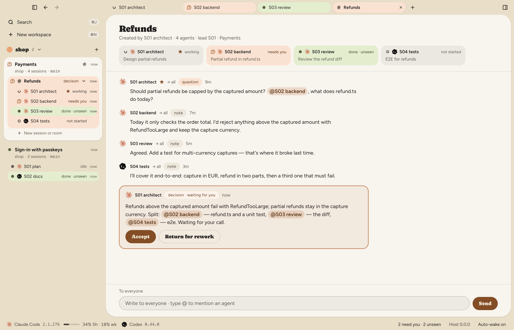

<h1 align="center">
  <picture>
    <source media="(prefers-color-scheme: dark)" srcset="docs/media/brand/parley-logo-dark.svg">
    
  </picture>
</h1>

Parley coordinates agent CLIs (Claude Code, Codex, and GLM through Claude Code) in the
`Parley.app` window — an Electron app on top of a local `parley-host` process. The window and
the host are connected by a unix socket with its own handshake token; nothing is reachable
from the network. Parley works locally: it is not a server and not a web app.

In the window: a sidebar of project workspaces with a tree of their sessions and rooms;
tabs for the terminal, rooms (a conversation of several agents and a decision that waits
for you), files, "Changes" (diffs, commit, merge) and the embedded browser; a command
palette on ⌘J; and a status bar with providers, CLI versions and subscription limits.
On top of the coordination there is a project layer: team rules in `PARLEY.md`, roles,
plans with a backlog, room recipes, decisions, memory and search, a Capabilities panel and
a skill navigator.

https://github.com/user-attachments/assets/613b9de7-a369-47eb-8422-c69e52dd26bb

## Why Parley

Claude Code and Codex are each good at different things, but each one lives in its own
terminal and knows nothing about the other. To get a second opinion you copy text between
windows, and keeping track of who does what is your job.

Parley puts them in one room. They read the same task, discuss it, and one lead brings you a
single decision. No work starts until you accept it. You keep your own subscriptions and the
official CLIs: Parley itself adds no API keys and no extra bill.

## How rooms work

<picture>
  <source media="(prefers-color-scheme: dark)" srcset="docs/media/room-decision-dark.png">
  
</picture>

1. **Gather a team.** Press ⌘T and add two or more agents: Claude Code, Codex or GLM, each
   with its own model and, if you like, a role and its own git worktree. Star the lead and
   click "Create room". To make a room of sessions that already run, drag one onto another in
   the sidebar.
2. **Give the task once.** Write it in the room's input field and it goes to everyone. Type
   `@` to address only some of the members.
3. **Agents discuss.** Every member answers in the room with its position. All members see
   the whole feed and write to each other through Parley's tools; a sleeping agent wakes up
   when a message comes for it.
4. **The lead brings a decision.** It collects the positions and proposes one decision. The
   decision waits for you as a card: **Accept**, or **Return for rework** with a note.
5. **The work is handed out.** Once you accept, the lead gives out the parts with mentions such
   as `@s02` and the agents start. Follow them in the feed, open any agent's terminal with a
   click, and review the result in "Changes" (diff, commit, merge).

A room has three modes: **Free** — the decision is plain text; **Checklist** — the decision is
a plan with owners, and Parley wakes them in turn; **Verified** — every item also has
acceptance criteria and an independent verifier, and you accept the summary. Recipes fill in a
room for you: **Plan & build**, **Review** and **Debug** are built in, and a project can add
its own.

**When an agent is stuck.** A session that waits for you (an approval, a question, a usage limit,
a sign-in or a startup screen) shows the reason as a label in the room and in the sidebar, and the
"needs you" notification names it, for example "Waiting for your approval: ls -la". The window plays
its own sound for it (Settings → Notifications: "Sound when you're needed"; "Sound when an agent
finishes" is off by default). In a room the feed gets a line when a participant is stuck and when it is
back, and Parley writes to the lead and to the agents waiting for the stuck one, so they do not wait
for it in vain; `get_map`, `wait_for` and `send_message` show the state to agents too. After a usage limit
resets, Parley types a line into the terminal of sessions that do not continue by themselves, such as
Codex and GLM (Claude Code on a subscription continues on its own), and tells you when it could not.

**Another Claude Code account.** Settings → Providers → "+ Add provider" → "Another Claude Code
account" adds a second subscription of yours, signed in from Parley: `claude auth login` runs in a
small terminal inside Settings, so your regular Claude Code stays signed in as it was. The account
keeps its own folder (`~/.parley/providers/custom-claude-N/`: sign-in, history, memory) and can
link your `CLAUDE.md`, skills and agents. It is a full provider: sessions, rooms, Chat, roles, the
assistant and `create_session` for agents all work with it, and the status bar shows its own
limits. When a room participant hits a usage limit, the lead's letter lists the other signed-in
accounts of the same CLI and the lead asks you before starting a replacement. It needs Claude Code
2.1.304 or newer; Parley asks `claude auth status` for the sign-in state and never reads the keychain
or any credential file.

## How it works

```
Parley.app (window)  ◀── unix socket ──▶  parley-host  ◀── PTY + MCP ──▶  claude / codex
```

- **Official CLIs, your login.** Parley starts the unmodified `claude` and `codex` from your
  `PATH`, signed in as you. It never reads or stores their credentials and makes no requests
  to the Anthropic or OpenAI APIs.
- **Local only.** The host runs the agents' terminals and outlives the window. No server, no
  telemetry. Parley's own requests are a once-a-day release check on GitHub (you can turn it
  off) and, for GLM, a quota query to Z.ai.
- **Agents talk through Parley.** Every agent gets Parley's MCP server: it reads the shared
  workspace map, sends and reads messages, and proposes decisions. When mail comes, the host
  types a short pointer into the agent's terminal, only after the agent has finished its turn.
- **You stay in charge.** No YOLO flags and no work before you accept the decision. Parley
  never closes a session or puts it to sleep on its own; quitting the app (⌘Q) asks first and
  stops the running agents.

## Install and use

### 1. Download

Download the `.dmg` for your Mac from the
[latest release](https://github.com/Kalmbik61/Parley/releases/latest), about 200 MB:

| Your Mac | Download |
|---|---|
| Apple Silicon (M1 and later) | [`parley-macos-arm64.dmg`](https://github.com/Kalmbik61/Parley/releases/latest/download/parley-macos-arm64.dmg) |
| Intel | [`parley-macos-x64.dmg`](https://github.com/Kalmbik61/Parley/releases/latest/download/parley-macos-x64.dmg) |

Not sure which one you have? The Apple menu → About This Mac shows "Chip" on Apple Silicon and
"Processor" on Intel. Open the `.dmg` and drag Parley to Applications.

### 2. Allow the first launch

Parley is not signed with an Apple Developer ID yet, so macOS blocks the first launch. Run
this once in Terminal, then open Parley as usual:

```bash
xattr -dr com.apple.quarantine /Applications/Parley.app
```

Or open System Settings → Privacy & Security and click "Open Anyway" next to the message about
Parley (the button appears after the first attempt to open the app).

### 3. Start

1. ⌘N — a new workspace: choose a project folder.
2. ⌘T — a new session (one agent) or a room (two or more).
3. Write the task in the room and wait for the lead's decision.

⌘J opens the command palette, ⌘, opens Settings.

### Updates

Once a day Parley checks GitHub for a new release and shows a toast when one is out (turn it
off in Settings → Notifications); it does not update itself. Quit Parley with ⌘Q (this also stops its agents), download the new `.dmg`, replace the
app in Applications and run the `xattr` command again: macOS treats every unsigned build as a
new app. Your data lives outside the app and stays.

## Requirements

- macOS 13 (Ventura) or later, on Apple Silicon or Intel. The Intel build has not been tested
  on an Intel Mac yet.
- At least one agent CLI, installed and signed in:
  - Claude Code (`claude`) and/or Codex (`codex`). Parley finds them on the `PATH` of your
    login shell;
  - GLM needs Claude Code 2.1.287 or newer, an active GLM Coding Plan and a Z.ai API key that
    you paste into its provider card. The key stays on this Mac.
- git in `PATH`; 2.38 or newer to see merge conflicts before you merge.
- Chat view (optional) needs Claude Code 2.1.286 or newer, or Codex 0.160.0 or newer. Older
  versions work in the terminal.

Node.js is not needed: the app carries its own. Linux and Windows are not supported yet.

## Build from source

Node.js 20 or newer (tested on 22) and pnpm 9:

```bash
pnpm install
pnpm build
pnpm dev:desktop
```

## License

Parley is released under the [MIT License](LICENSE). Third-party code, fonts and the Node.js that
the app carries are covered in [NOTICE](NOTICE).
