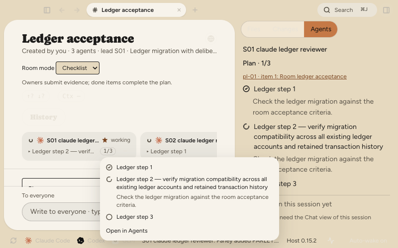
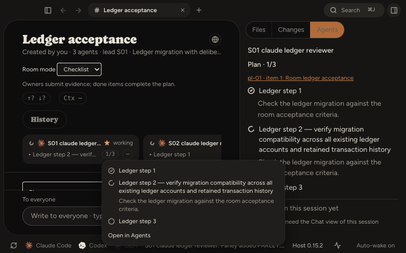

# Приёмка планов агентов — 2026-10-18

Реализация выполнена в ветке `codex/agent-plans`, база `5dbe95b6`. Задачи реализованы субагентами Sol 6.1; интеграция и проверки выполнены ведущим агентом. Все этапы прошли отдельное ревью; итоговое ревью интеграции — PASS.

## Что работает

- Общая свёртка подтверждённых TaskCreate/TaskUpdate, TodoWrite и update_plan; настоящие ID, порядок исходных вызовов, дедупликация, ошибки и поздние ответы.
- План сохраняется в полном и инкрементальном индексах без дополнительных чтений журнала, затем передаётся через живые метрики.
- Карточка участника показывает текущий/следующий шаг, прогресс и подсказку. Панель Agents раскрывает описания и связывает участника с назначениями плана комнаты.
- Открытие плана сохраняет комнату в фокусе. В окне 800×500 закрывается левый сайдбар. Переход к терминалу другой сессии снимает закрепление даже при закрытой панели Agents.
- Сводка считается до ограничения списка: 60 завершённых пунктов дают 60/60 и скрытый чип; текущий пункт №51 сохраняется. Неполная история помечается отдельно от скрытых отображением пунктов.
- Этапы субагентов используют ту же свёртку и реальные ID; потеря начала истории не перенумеровывает задачи.

## Проверки

| Проверка | Результат |
|---|---|
| Core | 3 342 passed, 1 skipped, 140 файлов |
| Host | 1 718 passed, 115 файлов |
| Desktop | 7 177 passed, 3 skipped; 383 passed / 1 skipped файл |
| TypeScript | core, protocol, host build; desktop typecheck — PASS |
| ESLint | все изменённые TS/TSX — PASS |
| Сборка Electron | PASS |
| Сквозной Electron-сценарий | PASS, 11 с |
| Ревью | Tasks 1–6 и итоговая интеграция — PASS |

Первый общий прогон core выявил ошибку системного Corepack в двух CLI-наборах: дочерний процесс выбирал другой Node и не находил ключ подписи менеджера пакетов. Повтор этих двух наборов с уже установленным pnpm 9.12.3 и закреплённым Node дал 30/30 PASS; остальные 138 наборов прошли изначально. Код приложения для обхода окружения не менялся.

Ревью выявило две исправленные проблемы: описание не раскрывалось при переходе существующего шага в in_progress; длинное пояснение вытесняло содержимое hover за пределы окна. Оба исправления покрыты регрессионными тестами и повторным ревью.

## Скорость индексации

Тот же локальный журнал размером 212 481 611 байт; базовый исходник до изменений и текущий индекс запускались попеременно в одном процессе, после прогрева, семь измерений каждого.

- До: медиана 643,60 мс.
- После: медиана 649,33 мс.
- Разница: +0,89%, ниже допустимых 10%.

Первоначальные раздельные замеры совпали с другими проверками и дали шумное замедление; контрольный парный замер устранил различие условий. Содержимое и персональный путь журнала в отчёт не включены.

## Electron-приёмка

Сценарий `packages/desktop/e2e/agent-plans.spec.ts` создаёт изолированные каталоги, комнату с двумя Claude и одним Codex и журналы в нативном формате. Планы проходят настоящий индекс и activity service. Проверены карточка, наведение, описания, ссылка на пункт плана комнаты, закрепление и его сброс при открытой/закрытой панели, узкое окно, длинное название, текущий пункт №51, завершённые 60 пунктов и предупреждение неполного плана без точного счётчика.

Первый запуск выявил ошибку самой фикстуры: более длинный снимок перезаписывал существующий файл на месте, что не является append. Фикстура теперь меняет снимки через ротацию файла, корректно сбрасывая инкрементальный курсор. Финальный сценарий прошёл целиком.

Это приёмка на нативных фикстурах в настоящем Electron-окне, а не наблюдение вызовов платных CLI в живой работе. Реальные новые вызовы update_plan у Codex и планирования у запущенного субагента в этой сессии не наблюдались; поддержка форматов и усечённой истории проверена тестами. Codex без подтверждённых плановых вызовов остаётся без плана.

## Снимки 800×500

Светлая тема:

Тёмная тема:

